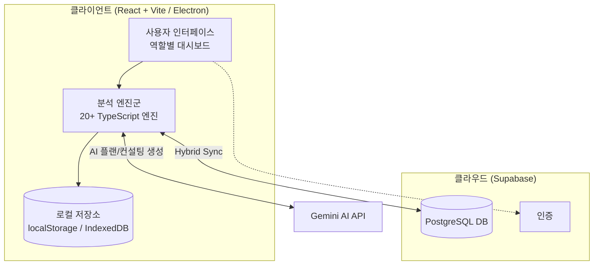
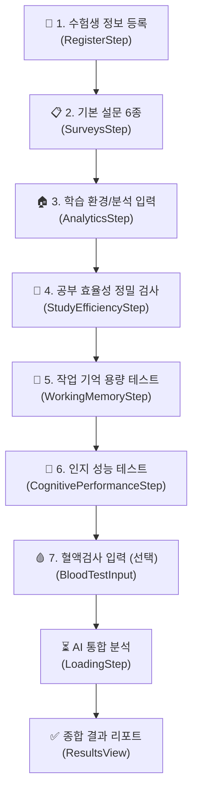

# NBASS — Neuro-Bio Academic Strategy System
### 뇌-신체 과학 기반 수험생 통합 학습 케어 플랫폼

> **문서 버전**: v1.0
> **앱 이름**: Mind-Body Connect Student Integrated Care System (NBASS)
> **대상**: 수험생(중·고등학생/N수생), 학부모, 학원·컨설턴트, 의료 전문가, 서비스 오너

---

## 1. 앱 개요 (Executive Summary)

NBASS는 단순 심리검사 앱이 아닙니다. 수험생의 **설문 응답, 인지 테스트 결과, 학습 환경 데이터, 혈액검사 수치**를 통합 분석하여, 개인별 **케어 타입(CareType)을 진단**하고 **맞춤형 학습 처방전(전략·영양·수면·루틴)**을 자동 생성해주는 통합 케어 시스템입니다.

### 핵심 가치 제안
| 구분 | 내용 |
| :--- | :--- |
| **누구를 위해** | 시험 불안, 집중력 저하, 성적 정체로 고민하는 수험생과 그 학부모 |
| **무엇을 하는가** | 3분 무료 진단 → 12종 케어타입 분류 → AI 맞춤 학습/생활 처방 |
| **어떻게 차별화되는가** | 설문 + 인지 게임 테스트 + AI 엔진이 결합된 정밀 진단 및 처방 |
| **결과물** | 인쇄 가능한 종합 리포트, AI 공부 계획, 성적 시뮬레이션, 카카오톡 알림 |

---

## 2. 기술 스택 (Tech Stack)

| 레이어 | 기술 |
| :--- | :--- |
| **프레임워크** | React 19 + TypeScript + Vite |
| **데스크톱 패키징** | Electron 40 (NSIS 설치 프로그램, Windows/macOS) |
| **스타일링** | TailwindCSS 4 + PostCSS |
| **차트/시각화** | Recharts 3 |
| **AI 엔진** | Google Gemini (`@google/genai`) |
| **클라우드 DB/인증** | Supabase (PostgreSQL, Auth) |
| **로컬 DB** | Dexie (IndexedDB 래퍼) + localStorage |
| **OCR** | Tesseract.js + PDF.js (성적표 이미지/PDF 자동 인식) |
| **아이콘** | Lucide React |
| **PWA** | Service Worker + Web App Manifest (모바일 설치 지원) |

### 실행 명령어
```bash
npm install          # 의존성 설치
npm run dev          # 웹 개발 서버 (Vite)
npm run build        # 타입 체크 + 프로덕션 빌드
npm run electron:dev # Electron 개발 모드
npm run electron:build # Electron 설치 프로그램 빌드
```

---

## 3. 시스템 아키텍처



### Hybrid Sync 전략
- **오프라인 우선**: 모든 진단 데이터는 먼저 로컬(localStorage/IndexedDB)에 저장되어 오프라인에서도 완전 동작
- **클라우드 동기화**: Supabase를 통해 학생/학부모/전문가 간 데이터 동기화 (`services/syncService.ts`)
- **멀티 플랫폼**: 웹 브라우저(모바일/PC) + Electron PC 앱 양쪽 지원

---

## 4. 사용자 역할 (User Roles)

앱은 [RoleSelectionView](components/RoleSelectionView.tsx)를 통해 5가지 역할로 진입합니다.

| 역할 | 설명 | 주요 화면 |
| :--- | :--- | :--- |
| **수험생 (Student)** | 진단 검사 응시, 결과 리포트 열람, 학습 관리 | 진단 플로우, 대시보드, 오답노트 |
| **학부모 (Parent)** | 자녀 결과 확인, 주간 알림 수신 | [ParentDashboard](components/dashboards/ParentDashboard.tsx), 학부모 디렉터리 |
| **의료 전문가 (Medical Expert)** | 임상 바이오데이터 열람, 처방 관리 | [ExpertDashboard](components/dashboards/ExpertDashboard.tsx) |
| **학원·컨설턴트 (Academy Expert)** | 원생 학습 모니터링, 상담 스크립트 | 전문가 대시보드 |
| **오너/관리자 (Owner/Admin)** | 전체 DB 관제, 로직 설정, 마케팅 | [OwnerDashboardView](components/dashboards/OwnerDashboardView.tsx), 관제 포털 |

> 관리자 포털은 인증 모달([AuthLoginModal](components/modals/AuthLoginModal.tsx))을 통과한 후 접근할 수 있으며, 수험생 DB / 학부모 DB / 의료 관제 / 학원 관제 / 오너 대시보드 5개 모듈로 구성됩니다.

---

## 5. 핵심 기능 상세

### 5.1 진단 플로우 (Assessment Pipeline)

수험생이 웹앱에서 단계별로 진행하는 검사 흐름입니다. 각 단계는 [components/steps/](components/steps/) 폴더의 개별 컴포넌트로 구현되어 있습니다.



#### 단계별 상세

**① 수험생 정보 등록** — 이름, 학년, 생년월일, 지역, 시험일 등 기본 프로필 입력. 자동 채번된 학생 ID(`generateSerialID`)로 이후 모든 데이터가 추적됩니다.

**② 기본 설문 6종** ([data/questions.ts](data/questions.ts))
- **BAI** (Beck Anxiety Inventory): 불안 수준
- **ISI** (Insomnia Severity Index): 수면 장애
- **CFS** (Chronic Fatigue Scale): 만성 피로
- **교감신경 증상 / 부교감신경 증상**: 자율신경 계열 증상 체크
- **집중력 설문 / 부신(Adrenal) 설문**: 인지·호르몬 관련 자가 진단

**③ 학습 환경/분석 입력** — 학습 시간대, 수면 패턴, 스마트폰 사용량, 과목별 우선순위(중요도/성적/집중투자 랭킹) 등 학습 습관 데이터 수집

**④ 공부 효율성 정밀 검사** ([StudyEfficiencyAssessment](components/StudyEfficiencyAssessment.tsx))
- 크로노타입 (아침형/저녁형): 최적 학습 시간대 산출
- VARK 학습 스타일 (시각/청각/읽기/운동감각)
- 시험 불안 (TAI): 개입 전략 매칭
- 디지털 중독: 디지털 디톡스 프로토콜 제안
- 메타인지: 자기 점검 학습법 추천

**⑤ 작업 기억 용량 테스트** ([WorkingMemoryAssessment](components/WorkingMemoryAssessment.tsx)) — 숫자 거꾸로 외우기(Digit Span), N-Back 등 미니게임형 테스트로 작업 기억 스팬 측정

**⑥ 인지 성능 테스트** ([CognitivePerformanceAssessment](components/CognitivePerformanceAssessment.tsx)) — Go/No-Go 과제 기반 주의력·충동성 제어 능력 실측

**⑦ 혈액검사 입력 (선택)** — 빈혈/갑상선/비타민D 등 수치 입력 시 의학 엔진([medicalEngine](services/))이 추가 분석

---

### 5.2 12가지 케어 타입 분류 (CareType Classification)

모든 검사 데이터를 취합하여 [logicEngine.ts](logicEngine.ts)의 규칙 엔진이 12+1개 유형으로 분류합니다. ([types.ts](types.ts) 참조)

| 축 | 케어 타입 |
| :--- | :--- |
| **정서/자율신경 (SNS 과활성)** | 과긴장 번아웃(Hyper-Tension Burnout) · 불안-긴장형(Anxiety-Tension) · 스트레스 과부하(Stress Overload) |
| **정서/자율신경 (PNS 과활성)** | 무기력형(Low-Energy Fatigue) · 우울-무동기형(Depression-Amotivation) · 부신피로(Adrenal Fatigue) |
| **뇌/인지 축** | 뇌피로 집중곤란(Brain Fatigue) · 과민성 학습장애(Hypersensitive) · 주의력 산만형(Attention Deficit) |
| **신체/대사 축** | 수면 장애형(Sleep Dysfunction) · 혈액순환 저하형(Poor Circulation) |
| **건강 상태** | 건강 균형형(Healthy Balance) |

**분류 정확도 강화 기능:**
- **주분류 + 부분류(최대 2개)** 동시 산출
- 부분류는 점수에 따라 `확정 진단`(70점 이상) / `근접 추정`(50~69점) 라벨 구분
- 분류 근거(reasoning)와 전체 유형 점수표 제공
- 관리자가 [RuleEditor](components/modals/RuleEditor.tsx)에서 분류 규칙/제품 추천 규칙을 직접 편집 가능하며, [LogicSimulator](components/modals/LogicSimulator.tsx)로 시뮬레이션 검증

---

### 5.3 AI 분석 엔진 (Analysis Engines)

`services/` 폴더에 구현된 전문 엔진들이 결과 리포트를 생성합니다.

| 엔진 | 파일 | 역할 |
| :--- | :--- | :--- |
| **임상 분석** | [clinicalEngine.ts](services/clinicalEngine.ts) | 설문+바이오데이터 임상 해석 |
| **분류 엔진** | [logicEngine.ts](logicEngine.ts) | 12종 케어타입 규칙 분류 (사용자 편집 가능) |
| **AI 학습 플랜** | [aiGradePlanEngine.ts](services/aiGradePlanEngine.ts) | 성적+목표 Gap 분석 → AI 맞춤 공부 계획 (Gemini / 규칙엔진 하이브리드) |
| **예측 엔진** | [predictionEngine.ts](services/predictionEngine.ts) | 뇌-신체 위험도 예측 분석 |
| **성적 시뮬레이션** | [gradeSimulationEngine.ts](services/gradeSimulationEngine.ts) | 목표 대학 합격 시뮬레이션 |
| **스케줄링** | [schedulingEngine.ts](services/schedulingEngine.ts) | 크로노타입 기반 AI 시간표 생성 |
| **처방 엔진** | [prescriptionEngine.ts](services/prescriptionEngine.ts) | 영양/수면/이완 처방전 생성 |
| **영양 처방** | [vitaminCProtocol.ts](services/vitaminCProtocol.ts), [TargetedNutritionRecommendation](components/TargetedNutritionRecommendation.tsx) | 1:1 맞춤 영양제 처방 |
| **상담 스크립트** | [consultationScriptEngine.ts](services/consultationScriptEngine.ts), [consultingEngine.ts](services/consultingEngine.ts) | 상담 멘트/상담장 자동 생성 |
| **오답노트 처방** | [wrongNotePrescriptionEngine.ts](services/wrongNotePrescriptionEngine.ts) | 오답 패턴별 학습 전략 처방 |
| **학습 전략** | [studyStrategyEngine.ts](services/studyStrategyEngine.ts), [studyEfficiencyService.ts](services/studyEfficiencyService.ts) | 학습 효율 분석 및 전략 매칭 |
| **시간생물학** | [chronobiologyEngine.ts](services/chronobiologyEngine.ts) | 서카디안 리듬 기반 수면/학습 리듬 분석 |
| **OCR** | [ocrEngine.ts](services/ocrEngine.ts), [ocrDataMapper.ts](services/ocrDataMapper.ts) | 성적표 사진/PDF 자동 인식 → 성적 입력 |
| **추천 엔진** | [recommendationEngine.ts](services/recommendationEngine.ts) | 케어타입별 제품/콘텐츠 추천 |

> **AI 하이브리드 설계**: [aiGradePlanEngine.ts](services/aiGradePlanEngine.ts)는 규칙 엔진(비용 0원, 즉시 생성)을 기본으로 하고, 멤버십 등급에 따라 Gemini AI 생성 플랜을 월 할당량(프리미엄 월 5회 ~ VIP 주 5회)만큼 제공합니다.

---

### 5.4 결과 리포트 (Results Report)

[ResultsView](components/steps/ResultsView.tsx)에서 제공하는 종합 리포트:

- **케어타입 결과 카드**: 주분류 + 부분류(확정/근접추정) + 점수 + 분류 근거
- **맞춤 전략 패널**: 영양 / 학습 / 운동 / 루틴 4대 영역 처방
- **인지 리포트**: 작업 기억, 주의력, 처리속도 그래프 ([NeuroInsightReport](components/NeuroInsightReport.tsx))
- **성적 시뮬레이션**: 현재 성적 → 목표 대학 예측 ([PredictionReport](components/PredictionReport.tsx))
- **상담 탭**: 학부모 상담 스크립트, 상담 편지 자동 생성 ([ConsultantTabs](components/ConsultantTabs.tsx))
- **인쇄/PDF**: [printUtils.ts](utils/printUtils.ts) 기반 원클릭 리포트 인쇄
- **무료 요약 티저**: [FreeSummaryTeaser](components/steps/FreeSummaryTeaser.tsx) — 무료 사용자에게 1줄 요약만 공개, 전체 리포트는 유료 잠금

---

### 5.5 멤버십 등급 및 기능 잠금 (Feature Gate)

[featureGate.ts](utils/featureGate.ts)에서 등급별 기능 접근을 제어합니다.

| 등급 | 가격 | 핵심 기능 |
| :--- | :--- | :--- |
| 🌱 **FREE** | ₩0 | 3분 기본 진단, 케어타입 분류, 1줄 요약 |
| ⚡ **PRO** | ₩9,000 (1회) | 1회 학생용 풀 리포트 열람 |
| 💎 **PREMIUM** | ₩9,900/월 | 심층 리포트 무제한, 성적 관리·시뮬레이션, 영양 처방, 카카오톡 주간 알림, AI 공부 시간표 |
| ✨ **PREMIUM PLUS** | ₩19,900/월 | + AI 1:1 학습 클리닉, 14P 의학 리포트북 PDF, 스마트 케어 스케줄러 |
| 👑 **VIP** | ₩29,900/월 | 전 기능 무제한 + 수면 관리, 멘탈 케어, 예측 엔진 |
| 🩺 **EXPERT** | 전문가용 | 전 기능 100% 무제한 해금 |

- `canAccess(tier, feature)` 함수로 기능별 접근 제어
- AI 플랜 생성은 등급별 월 할당량 관리 (localStorage 기반 사용량 추적)

---

### 5.6 학습 관리 도구 (Study Management)

| 기능 | 설명 |
| :--- | :--- |
| **성적 관리** ([GradeManagementView](components/grade-management/)) | 과목별 성적 입력, OCR 성적표 자동 인식, 성적 추이 차트, 대학별 커트라인 비교 ([data/gradeCutoffs.ts](data/gradeCutoffs.ts)) |
| **오답노트** ([WrongNotes](components/WrongNotes.tsx)) | 오답 기록 + 패턴 분석 + AI 처방전 연동, localStorage 영구 저장 |
| **학습 관리** ([StudyManagementView](components/study-management/StudyManagementView.tsx)) | 뽀모도로 타이머([PomodoroTimer](components/PomodoroTimer.tsx)), 능동적 회상([ActiveRecallModal](components/ActiveRecallModal.tsx)) |
| **수면 관리** ([SleepManagementView](components/sleep-management/)) | 크로노타입 기반 수면 루틴, 서카디안 리듬 관리 |
| **일정 관리** ([ScheduleManagementView](components/schedule-management/)) | AI 생성 시간표 기반 스마트 케어 스케줄 |
| **스트레스 케어 랩** ([StressCareLabView](components/StressCareLabView.tsx)) | 호흡 가이드([BreathingGuide](components/BreathingGuide.tsx)), 스트레칭([StretchingGuide](components/StretchingGuide.tsx)), 백색소음([LocalWhiteNoise](components/LocalWhiteNoise.tsx)), 웰니스 플레이어([WellnessPlayer](components/WellnessPlayer.tsx)) |
| **목표 & AI 플랜** ([GoalsAndAIPlan](src/components/GoalsAndAIPlan.tsx)) | 과목별 목표 설정 → AI가 성적/오답/컨디션 데이터 종합하여 주간 플랜 생성 |

---

### 5.6 학부모 연동 (Parent Integration)

- **카카오톡 주간 알림톡** ([ParentKakaoTalk](src/components/ParentKakaoTalk.tsx)): 자녀의 주간 컨디션/성적 요약을 카카오톡으로 발송 (PREMIUM 이상)
- **학부모 대시보드** ([ParentDashboard](components/dashboards/ParentDashboard.tsx)): 자녀 진단 결과, 학습 현황 모니터링
- **학부모 디렉터리** (관리자용): 전체 학부모 DB 및 자녀 연계 관리

---

### 5.7 관리자/오너 기능 (Admin & Owner)

- **관제 포털** ([RoleSelectionView](components/RoleSelectionView.tsx)): 수험생 DB / 학부모 DB / 의료 관제 / 학원 관제 / 오너 대시보드
- **로직 설정** ([ConfigModal](components/modals/ConfigModal.tsx)): 분류 규칙, 제품 추천 규칙, 예측 규칙을 UI에서 직접 편집 → `logicEngine.ts`에 저장
- **수험생/학부모 통합 DB** ([StudentDirectoryView](components/dashboards/StudentDirectoryView.tsx), [ParentDirectoryView](components/dashboards/ParentDirectoryView.tsx)): 전체 회원 열람 및 등급(Tier) 관제
- **히스토리 분석** ([HistoryAnalysisManager](components/HistoryAnalysisManager.tsx), [ProgressAnalytics](components/ProgressAnalytics.tsx)): 검사 이력 추이 및 진행 분석
- **라이선스 시스템** ([licenseManager](utils/licenseManager.ts), [LicenseActivation](components/ui/LicenseActivation.tsx)): 라이선스 키 활성화 및 유효성 검사

---

## 6. 데이터 저장 구조

| 저장소 | 용도 |
| :--- | :--- |
| **localStorage** | 현재 세션 상태, 오답노트, 멤버십 등급, AI 사용량 카운터, 역할 정보 |
| **IndexedDB (Dexie)** | 대용량 검사 이력, 로컬 캐시 (오프라인 지원) |
| **Supabase** | 학생/학부모/전문가 계정, 검사 결과 동기화, 성적, 알림 설정 |

- 자동 저장 훅: [useAssessmentDraft](hooks/useAssessmentDraft.ts) — 검사 중간에 새로고침해도 이어서 진행
- 동기화 서비스: [syncService.ts](services/syncService.ts) — 설문/프로토콜/분석 번들을 클라우드와 양방향 동기화

---

## 7. 주요 사용자 시나리오

### 시나리오 1: 수험생 무료 진단
1. 랜딩 → "3분 무료 진단" 클릭
2. 학생 정보 입력 → 설문 6종 → 학습 환경 입력
3. 인지 게임 테스트 (작업 기억 + Go/No-Go)
4. AI 분석 → **케어타입 + 1줄 요약** 무료 공개
5. 상세 리포트는 유료 등급에서 잠금 해제

### 시나리오 2: 학부모 정기 구독
1. 자녀 진단 결과 열람 (PRO 1회권 또는 PREMIUM 구독)
2. 매주 카카오톡 알림톡으로 자녀 컨디션/성적 요약 수신
3. 성적 시뮬레이션으로 목표 대학 합격 가능성 확인
4. AI 맞춤 공부 시간표 및 영양 처방전 수령

### 시나리오 3: 전문가 상담
1. 전문가 인증 로그인 → 전체 수험생 DB 열람
2. 특정 학생의 임상 데이터 및 리포트 확인
3. 상담 스크립트 엔진으로 상담 멘트 생성
4. 처방전 발급 및 인쇄

---

## 8. 프로젝트 구조 (Directory Structure)

```
├── App.tsx                  # 메인 앱 (진단 플로우 스텝 머신 + 라우팅)
├── types.ts                 # 전역 타입 정의 (CareType, HRV, 설문 등)
├── logicEngine.ts           # 분류/추천 규칙 엔진 (사용자 편집 가능)
├── components/
│   ├── steps/               # 진단 플로우 단계별 컴포넌트
│   ├── dashboards/          # 역할별 대시보드 (학생/학부모/전문가/오너)
│   ├── modals/              # 인증, 설정, 규칙 편집기, 시뮬레이터
│   ├── games/               # 인지 테스트 미니게임 (DigitSpan, Stroop 등)
│   ├── grade-management/    # 성적 관리
│   ├── sleep-management/    # 수면 관리
│   ├── study-management/    # 학습 관리
│   └── reports/             # 리포트 컴포넌트
├── services/                # 20+ 분석/AI 엔진
├── data/                    # 문항, 전략, 커트라인 등 지식 베이스
├── hooks/                   # 상태 관리 훅 (자동저장, 다크모드, 동기화)
├── contexts/                # React Context (학습 효율성 등)
├── utils/                   # featureGate, licenseManager, printUtils 등
├── lib/                     # Supabase 클라이언트
├── electron/                # Electron 메인 프로세스
└── public/                  # 랜딩 페이지, PWA 매니페스트, 서비스워커
```

---

## 9. 보안 및 프라이버시

- **개인정보 처리방침/동의서**: 회원가입 시 동의 체크 필수
- **역할 기반 접근 제어(RBAC)**: 수험생/학부모/전문가/관리자별 열람 범위 분리
- **Supabase RLS**: 행 수준 보안 정책 적용
- **전문가 등급**: 검증 목적으로 전 기능 무제한 해금 (내부 검증용)

---

## 10. 요약

NBASS는 **"검사 → 진단 → 처방 → 관리"**의 완결된 루프를 갖춘 수험생 통합 케어 시스템입니다.

1. **검사**: 설문 6종 + 공부 효율성 + 작업 기억 + 인지 성능 테스트
2. **진단**: 12종 케어타입 자동 분류 (주분류 + 부분류 + 근거)
3. **처방**: AI 맞춤 학습 플랜, 영양/수면/멘탈 처방전
4. **관리**: 성적 관리, 오답노트, 스케줄러, 카카오톡 알림으로 지속 케어
5. **확장**: 웹(모바일/PC) + Electron 데스크톱 + PWA 하이브리드 아키텍처
