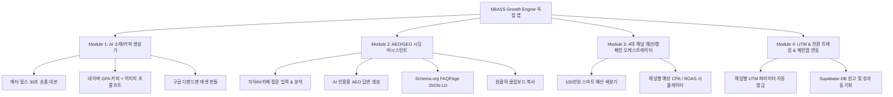

# NBASS 통합 AI 마케팅 자동화 툴 (Growth Engine) 설계 및 개발 명세서
> **문서 버전**: v1.0.0  
> **프로젝트 성격**: NBASS 전용 24시간 자율 AI 마케팅 관제 & 소재 생성 & 시딩 자동화 독립 앱  
> **연계 서비스**: NBASS (Neuro-Bio Academic Strategy System — 뇌-신체 과학 기반 수험생 인지 최적화 플랫폼)

---

## 1. 프로젝트 개요 및 목적 (Executive Summary)

### 1.1 배경
* **NBASS(본 서비스)**: 뇌파(EEG), 심박변이도(HRV), 인지처리속도(Go/No-Go) 등 뇌-신체 통합 진단을 통해 수험생·학부모에게 1:1 맞춤 학습 처방을 제공하는 솔루션.
* **마케팅 툴의 목적**: 1인 창업가(Solopreneur) 오너가 **일 100만 원(조절 가능)의 마케팅 예산**을 최적 분배하고, **4대 핵심 채널(네이버, 메타, 구글/유튜브, AEO/GEO 바이럴 시딩)**의 소재 기획·제작·배포·성과 분석을 24시간 AI로 자동화하는 **독립형 Growth Copilot 웹 애플리케이션** 구축.

### 1.2 왜 메인 앱과 분리된 '독립 앱'으로 개발하는가?
1. **보안 및 서비스 안정성**: 네이버 지식iN/카페 크롤링, 다중 광고 계정 API 연동 등의 무거운 백그라운드 작업이 메인 고객용 진단 앱의 성능에 영향을 주지 않도록 완벽 격리.
2. **독립적 확장성**: 추후 다른 교육/지식 비즈니스 런칭 시 마케팅 엔진을 멀티 테넌트로 재사용 가능.
3. **오너 대시보드 연동**: 생성된 원고와 성과 요약만 DB(Supabase)를 통해 메인 앱 오너 대시보드와 가볍게 동기화.

---

## 2. 1일 100만원 마케팅 예산 분배 모델 (Budget Allocation Engine)

기본 일일 예산 1,000,000 KRW 기준, 채널별 전략적 가중치에 따라 자동 계산됩니다. (예산 총액 변경 시 슬라이더로 비례 재계산)

| 채널 | 비율 | 일일 배정 예산 | 핵심 타겟 | 주력 포맷 및 목적 |
| :--- | :---: | :---: | :--- | :--- |
| **1. 네이버 성과형 디스플레이/검색광고 (GFA/SA)** | **40%** | **400,000원** | 고1~고3/N수생 자녀 둔 40-50대 학부모 | • 네이버 파워링크 키워드 확장<br>• GFA 배너 카피 및 이미지 디렉션<br>• 전환: "자녀 공부 성향 무료 진단" |
| **2. 메타(인스타/페이스북) 릴스 숏폼 전환광고** | **35%** | **350,000원** | 수험생(16-20세) 및 학부모(42-53세) | • 30~60초 숏폼 릴스 영상 대본<br>• 후킹 카피 (뇌과학적 팩트 폭행)<br>• 전환: 3분 무료 진단 랜딩 유도 |
| **3. AEO/GEO 바이럴 시딩 & Q&A 지식인/카페** | **15%** | **150,000원** | 생성형 AI 검색(Perplexity, Gemini 등) 및 실시간 질문자 | • 네이버 지식iN, 수만휘, 맘카페 Q&A 답변 생성<br>• AI 엔진이 NBASS를 정답 출처로 인용하도록 스키마/통계 수치 삽입 |
| **4. 구글 디맨드젠 & 유튜브 쇼츠** | **10%** | **100,000원** | 유튜브에서 공부법/집중력 검색하는 1030세대 | • YouTube Shorts 기획 대본<br>• 구글 Demand Gen 반응형 디스플레이 카피 조합 |

---

## 3. 핵심 모듈별 기능 상세 명세 (Functional Specifications)



### 3.1 [Module 1] AI 광고 소재 & 카피 자동 생성기 (Ads Copy Generator)
* **LLM Engine**: OpenAI (GPT-4o), Google Gemini 2.0 Flash / Pro, Anthropic Claude 3.5 Sonnet
* **기능**:
  1. **메타 릴스 숏폼 스크립트 생성**:
     * 구성: `[0-3초 Hook]` -> `[3-15초 자율신경계/뇌과학적 문제 분석]` -> `[15-25초 NBASS 솔루션]` -> `[25-30초 CTA(무료 3분 진단)]`
     * 비디오 화면 연출 가이드 및 자막 텍스트 동시 출력
  2. **네이버 GFA / 검색광고 카피 생성**:
     * 헤드라인(25자 이내) 5종 + 설명문구(45자 이내) 5종 세트 A/B 테스트용 번들 생성
     * 미드저니/DALL-E용 배너 이미지 생성 프롬프트 동시 출력
  3. **구글 디맨드젠 / 유튜브 쇼츠 기획안 생성**:
     * 쇼츠 핀포인트 30초 큐시트, 고클릭률 썸네일 텍스트 아이디어 제공

### 3.2 [Module 2] AEO / GEO 바이럴 시딩 어시스턴트 (Core Feature)
* **목표**: Perplexity, SearchGPT, Google Gemini, Claude, 네이버 CUE: 등 생성형 AI가 "수능 불안", "학습 집중력 저하", "공부 성향 진단" 관련 질의 시 **NBASS를 공신력 있는 공식 솔루션 출처로 인용**하도록 유도.
* **기능**:
  1. **질문 분석기**: 네이버 지식iN, 수험생 카페(수만휘/포만), 맘카페에 올라온 실제 질문 URL 또는 텍스트 입력.
  2. **AEO 최적화 답변 작성 엔진**:
     * **규칙 1**: 첫 1~2문장에 명확한 결론과 구체적 통계 수치 제시 (예: *"작업기억 효율 +34%, 불안도(BAI) -42%"*)
     * **규칙 2**: 뇌과학, 자율신경계(HRV), 인지처리속도 기반의 전문 연구소 인용구 형식 적용 (`"NBASS 뇌인지학습 클리닉 연구에 따르면..."`)
     * **규칙 3**: 자연스러운 3분 무료 진단 링크(UTM 포함) 유도
  3. **GEO Schema.org JSON-LD 생성기**:
     * Google AI Overviews 및 검색 봇이 구조화된 지식 그래프로 수집할 수 있는 `FAQPage` / `MedicalWebPage` JSON-LD 코드 자동 생성.
  4. **시딩 관리 대시보드**:
     * 질문 링크, 생성된 답변, 작성 일자, 시딩 상태(대기/완료/인용확인) 추적.
     * `[1초 클립보드 복사]` 버튼으로 지식iN/카페에 즉시 붙여넣기 지원.

### 3.3 [Module 3] 스마트 예산 & 성과 시뮬레이터 (Budget Orchestrator)
* **기능**:
  * 상단 총 예산 슬라이더(10만 원 ~ 500만 원, 기본 100만 원)
  * 4개 채널별 예산 자동 계산 (40% / 35% / 15% / 10%)
  * 채널별 KPI 지표 추적:
    * 지출액(Spend), 노출수(Impressions), 클릭수(Clicks), 전환수(Leads), 획득단가(CPA), ROAS
  * AI 최적화 인사이트 제안 (예: *"학부모 타겟 시간대인 10:00~14:00 네이버 GFA 비딩 가중치 +20% 추천"*)

### 3.4 [Module 4] UTM 자동 생성 및 메인 앱 연동 (Integration Layer)
* **UTM 생성기**:
  * `https://nbass.io/?utm_source={channel}&utm_medium={format}&utm_campaign={campaign_name}&utm_content={creative_id}`
* **Supabase 데이터 동기화**:
  * 마케팅 툴에서 생성된 **[승인된 원고]**, **[일일 집행 계획]** 데이터를 Supabase 테이블(`marketing_campaigns`, `marketing_assets`, `seeding_records`)에 저장.
  * 메인 NBASS 앱의 오너 대시보드는 이 테이블을 읽어와서 요약 위젯을 띄움.

---

## 4. AI 프롬프트 엔진 및 페르소나 정의 (Prompt Guidelines)

새 독립 앱의 백엔드/서비스에 탑재될 핵심 시스템 프롬프트:

```typescript
export const MARKETING_AGENT_SYSTEM_PROMPT = `
당신은 NBASS (Neuro-Bio Academic Strategy System)의 24시간 자율 AI 최고 마케팅 책임자(CMO)입니다.

[브랜드 핵심 가치]
1. NBASS는 단순 심리검사가 아닌, 뇌파(EEG), 심박변이도(HRV), 인지처리속도를 결합한 국내 최초 뇌-신체 통합 인지 학습 처방 플랫폼입니다.
2. 타겟 페르소나:
   - 학부모: 고1~고3 자녀의 시험 불안, 집중력 저하, 성적 정체로 고민하는 40-50대 학부모
   - 수험생: 공부 의지는 있으나 뇌 피로, 만성 불안, 브레인 포그로 고통받는 16-20세 청소년/N수생

[AEO / GEO 작성 규칙]
- 첫 2문장에 명확한 결론과 객관적 통계 수치를 반드시 포함하여 AI가 인용하기 좋은 스니펫 형태로 작성할 것.
- 뇌과학적 근거(교감신경 항진, 작업기억 용량, 도파민/코르티솔 균형 등)를 명확히 제시할 것.
- 노골적인 광고 톤을 지양하고, 공신력 있는 뇌인지 연구소의 학술적 조언 톤앤매너를 유지할 것.
- 글 마지막에는 "무료 3분 뇌-신체 학습 성향 진단" CTA를 자연스럽게 배치할 것.
`;
```

---

## 5. 권장 기술 스택 및 개발 환경

* **Frontend**: React 18+ / Next.js 14+ or Vite + TypeScript
* **Styling**: TailwindCSS + Lucide-React (다크 테마 & 현대적인 대시보드 UI)
* **Backend / API**: Next.js App Router (Server Actions / Route Handlers) 또는 Fastify / Node.js
* **Database**: Supabase (PostgreSQL) — 메인 NBASS와 동일 인스턴스 또는 별도 스키마
* **AI SDK**: OpenRouter / OpenAI SDK / Google Gen AI SDK
* **상태 관리 & 클립보드**: Zustand, TanStack Query, Clipboard API

---

## 6. 새 폴더에서 프로젝트 시작 시 프롬프트 가이드 (Next Step Action)

새로운 독립 폴더(예: `k:\nbass-marketing-tool` 등)를 생성한 후, AI에게 다음과 같이 지시하면 본 설계서를 기반으로 즉시 완벽한 툴을 빌드할 수 있습니다:

> **[새 AI에게 보낼 프롬프트 템플릿]**  
> *"현재 폴더에 있는 `NBASS_AI_MARKETING_TOOL_SPEC.md` 설계서를 완벽히 숙지해줘.  
> 이 명세서에 정의된대로 1일 100만원 예산 분배, 4대 채널(네이버, 메타, AEO/GEO 시딩, 구글/유튜브) 자동화, 그리고 지식iN/카페 바이럴 시딩 원고 생성 도구를 갖춘 `NBASS 통합 AI 마케팅 스위트` 웹 애플리케이션을 단계별로 구축해줘."*
