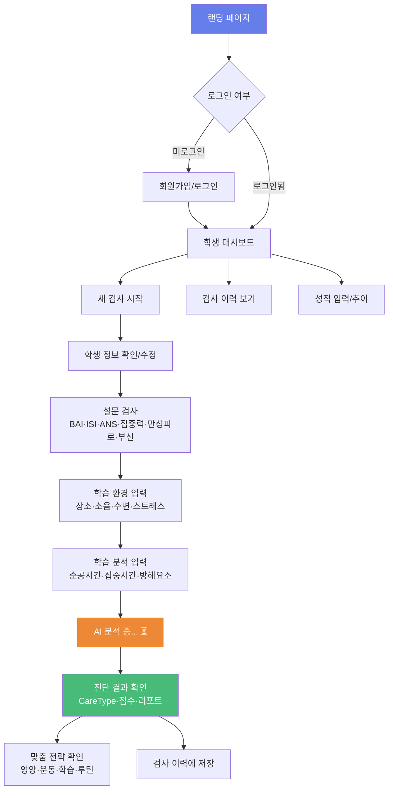

# NBASS 백엔드 + 웹앱 전환 실행 계획

## 현재 코드베이스 분석 요약

### 규모
| 영역 | 파일 수 | 총 크기 | 비고 |
|------|---------|---------|------|
| 메인 앱 (`App.tsx`) | 1 | 93KB (2046줄) | 50+개 상태 변수, 13개 모달 토글 |
| 컴포넌트 (`components/`) | 42+ | ~1.2MB | `ExpertOverlay` 402KB, `MedicalReport` 123KB |
| 서비스 엔진 (`services/`) | 29 | ~250KB | 핵심 비즈니스 로직 |
| 데이터/지식베이스 (`data/`) | 37 | ~760KB | 도메인 전문 지식 |
| 로직 엔진 (`logicEngine.ts`) | 1 | 40KB (1106줄) | 규칙 기반 진단 엔진 |
| 타입 정의 (`types.ts`) | 1 | 16KB | 모든 데이터 모델 |

### 핵심 발견

> [!IMPORTANT]
> **백엔드 추출 가능성: 양호** — `logicEngine.ts`의 핵심 평가 함수들은 모두 **순수 함수(pure function)**입니다. DOM이나 React에 의존하지 않아 서버로 직접 이관 가능합니다.

> [!WARNING]
> **리팩토링 필수** — `App.tsx`가 93KB 단일 파일이며, `RegisterStep`과 `LoadingStep`이 import되어 있지만 사용되지 않고 인라인 JSX가 대신 쓰이고 있습니다. 중복 코드도 존재합니다(Study Efficiency 업데이트 로직이 2곳에 복사).

---

## 아키텍처 결정

### 원래 로드맵 vs 수정 제안

| 영역 | 원래 로드맵 | 수정 제안 | 이유 |
|------|-----------|----------|------|
| 백엔드 서버 | Node.js + Fastify | **Next.js API Routes** | 별도 서버 운영 불필요, 프론트+백엔드 단일 배포 |
| 인증 | Firebase Auth / NextAuth | **Supabase Auth** | DB+Auth+Storage 통합 관리 |
| 데이터베이스 | PostgreSQL + Prisma | **Supabase (PostgreSQL)** | 무료 티어, 관리형 DB, RLS 보안 |
| 캐시 | Redis | **제거 (MVP)** | 초기 100명 규모에서 불필요 |
| 파일 저장 | AWS S3 | **Supabase Storage** | 통합 관리, 무료 1GB |
| 배포 | AWS EC2/ECS | **Vercel** | Next.js 최적화, 무료 티어 |
| 결제 | 토스/포트원 | **Phase 2로 연기** | MVP에서 결제는 불필요 |

### 최종 아키텍처

```
┌─────────────────────────────────────────────┐
│              Vercel (배포)                    │
│                                              │
│  ┌────────────────────────────────────────┐  │
│  │         Next.js 15 App Router          │  │
│  │                                        │  │
│  │  ┌──────────┐    ┌──────────────────┐  │  │
│  │  │ 페이지/UI │    │ API Routes       │  │  │
│  │  │ (React)  │    │ /api/assess      │  │  │
│  │  │          │───→│ /api/students    │  │  │
│  │  │          │    │ /api/reports     │  │  │
│  │  └──────────┘    └────────┬─────────┘  │  │
│  └───────────────────────────┼────────────┘  │
│                              │               │
└──────────────────────────────┼───────────────┘
                               │
                               ▼
┌──────────────────────────────────────────────┐
│            Supabase (인프라)                   │
│                                               │
│  ┌──────────┐  ┌──────────┐  ┌────────────┐  │
│  │ Auth     │  │PostgreSQL│  │ Storage    │  │
│  │(소셜로그인)│  │ (메인DB) │  │(리포트PDF) │  │
│  └──────────┘  └──────────┘  └────────────┘  │
└──────────────────────────────────────────────┘
```

> [!TIP]
> 이 구조의 장점: **서버 관리 0개**. Vercel + Supabase 모두 서버리스/관리형이라 인프라 운영 부담이 없습니다. 초기 비용은 **월 0~5만원**.

---

## User Review Required

> [!IMPORTANT]
> **기술 스택 승인 필요**: Supabase + Next.js + Vercel 조합으로 진행해도 괜찮으신지 확인이 필요합니다. 특히:
> 1. **Supabase Auth**: 카카오/네이버/구글 소셜 로그인을 지원합니다. 이메일+비밀번호 로그인도 함께 필요한지?
> 2. **Vercel 배포**: 한국 사용자가 주 대상이면 서울 리전(Vercel Edge)을 사용합니다.

> [!WARNING]
> **MVP 범위 확인 필요**: 아래 MVP에서 제외한 기능들이 있습니다. 반드시 MVP에 포함시켜야 할 것이 있다면 알려주세요.
> - HRV/EEG 입력 (→ 센터 방문 전용으로 Phase 2)
> - 혈액검사 (→ Phase 2)
> - 결제/구독 (→ Phase 2)
> - 모바일 앱 (→ Phase 3 이후)
> - 전문가용 다중 학생 관리 CRM (→ Phase 2)

---

## Open Questions

> [!IMPORTANT]
> 1. **도메인**: 웹앱의 도메인은 이미 확보하셨나요? (예: nbass.kr, mindbodyconnect.co.kr 등)
> 2. **Supabase 계정**: 이미 Supabase 계정이 있으신가요, 아니면 새로 만들어야 하나요?
> 3. **디자인**: 현재 Electron 앱의 UI 디자인을 그대로 가져갈지, 아니면 웹앱에 맞게 새로 디자인할지?
> 4. **기존 Electron 앱 유지**: 웹앱 전환 중에도 기존 Electron 앱은 계속 사용/유지하시나요?
> 5. **개인정보보호**: 건강 데이터(HRV, EEG, 설문) 수집 시 개인정보 처리방침 및 동의 절차 준비가 되어 있나요?

---

## Proposed Changes

### Phase 0: 기존 코드에서 공유 모듈 추출 (1주)

> 새 프로젝트를 만들기 전에, 기존 코드에서 **백엔드와 프론트엔드 모두에서 재사용할 코드**를 정리합니다.

---

#### [NEW] `packages/shared/types.ts`
기존 [types.ts](file:///C:/SN1/types.ts)에서 추출. 웹앱과 API 모두에서 사용할 공유 타입 정의.
- `CareType`, `ANSBalanceType` 열거형
- `StudentInfo`, `HRVData`, `SurveyData`, `AssessmentResult` 등 핵심 인터페이스
- `ClassificationResult`, `BrainBodyState`, `MedicalAnalysis` 등 결과 타입

#### [NEW] `packages/shared/logic-engine.ts`
기존 [logicEngine.ts](file:///C:/SN1/logicEngine.ts)에서 추출. 순수 함수만 분리.
- `evaluateCondition()`, `evaluateRule()` — 조건 평가
- `evaluateClassificationWithScores()` — 점수 기반 분류 (핵심)
- `evaluateProductRules()` — 제품 추천
- `evaluateSecretPointRules()` — 임상 알림
- `DEFAULT_CLASSIFICATION_RULES`, `DEFAULT_THRESHOLDS` 등 기본 규칙
- ⚠️ `localStorage` 의존성 제거 → DB 기반으로 교체

#### [NEW] `packages/shared/clinical-engine.ts`
기존 [clinicalEngine.ts](file:///C:/SN1/services/clinicalEngine.ts)에서 추출 (35KB).
- `generateClinicalAnalysis()` — 임상 분석 텍스트 생성

#### [NEW] `packages/shared/constants.ts`
기존 [constants.ts](file:///C:/SN1/constants.ts) + [data/](file:///C:/SN1/data/) 폴더의 정적 데이터 통합.
- 제품 카탈로그, CareType 레이블, 설문 문항 등

---

### Phase 1-A: Supabase 백엔드 구축 (2~3주)

---

#### [NEW] Supabase 프로젝트 설정
- PostgreSQL 데이터베이스 생성
- Row Level Security (RLS) 정책 설정
- Auth 프로바이더 설정 (Google, Kakao, Email)

#### [NEW] DB 스키마 (SQL 마이그레이션)

```sql
-- 사용자
CREATE TABLE users (
  id UUID PRIMARY KEY DEFAULT gen_random_uuid(),
  email TEXT UNIQUE NOT NULL,
  name TEXT NOT NULL,
  phone TEXT,
  role TEXT NOT NULL DEFAULT 'STUDENT'
    CHECK (role IN ('STUDENT', 'PARENT', 'EXPERT', 'ADMIN')),
  subscription_plan TEXT NOT NULL DEFAULT 'FREE'
    CHECK (subscription_plan IN ('FREE', 'BASIC', 'PREMIUM', 'VIP')),
  subscription_expires_at TIMESTAMPTZ,
  created_at TIMESTAMPTZ DEFAULT NOW(),
  updated_at TIMESTAMPTZ DEFAULT NOW()
);

-- 학생 프로필
CREATE TABLE students (
  id UUID PRIMARY KEY DEFAULT gen_random_uuid(),
  user_id UUID REFERENCES users(id) ON DELETE CASCADE,
  name TEXT NOT NULL,
  birth_date DATE,
  age INT,
  gender TEXT,
  school TEXT,
  grade TEXT,
  height NUMERIC,
  weight NUMERIC,
  bmi NUMERIC,
  mbti TEXT,
  weak_subject TEXT,
  parent_user_id UUID REFERENCES users(id),
  created_at TIMESTAMPTZ DEFAULT NOW()
);

-- 검사 기록
CREATE TABLE assessments (
  id UUID PRIMARY KEY DEFAULT gen_random_uuid(),
  student_id UUID REFERENCES students(id) ON DELETE CASCADE,
  assessment_date TIMESTAMPTZ DEFAULT NOW(),
  
  -- 입력 데이터
  survey_data JSONB,          -- 설문 결과 (BAI, ISI, ANS 등)
  protocol_data JSONB,        -- 학습 환경
  analytics_data JSONB,       -- 학습 분석
  hrv_data JSONB,             -- HRV (Phase 2)
  eeg_data JSONB,             -- EEG (Phase 2)
  blood_test_data JSONB,      -- 혈액검사 (Phase 2)
  
  -- 엔진 분석 결과
  care_type TEXT,
  care_score NUMERIC,
  classification_result JSONB,
  brain_body_state JSONB,
  analysis_text TEXT,
  medical_analysis JSONB,
  prediction JSONB,
  
  -- 처방/전략
  strategies JSONB,
  prescriptions JSONB,
  product_recommendations JSONB,
  
  -- 상태
  status TEXT DEFAULT 'SURVEY_ONLY'
    CHECK (status IN ('SURVEY_ONLY', 'HRV_ADDED', 'FULL_ASSESSMENT')),
  created_by UUID REFERENCES users(id),
  
  created_at TIMESTAMPTZ DEFAULT NOW()
);

-- 성적
CREATE TABLE grades (
  id UUID PRIMARY KEY DEFAULT gen_random_uuid(),
  student_id UUID REFERENCES students(id) ON DELETE CASCADE,
  exam_type TEXT,          -- 중간/기말/모의고사
  subject TEXT,
  score NUMERIC,
  grade_rank TEXT,
  exam_date DATE,
  created_at TIMESTAMPTZ DEFAULT NOW()
);

-- RLS 정책 (예시)
ALTER TABLE students ENABLE ROW LEVEL SECURITY;
CREATE POLICY "users_own_students" ON students
  FOR ALL USING (user_id = auth.uid());
CREATE POLICY "experts_view_students" ON students
  FOR SELECT USING (
    EXISTS (SELECT 1 FROM users WHERE id = auth.uid() AND role IN ('EXPERT', 'ADMIN'))
  );
```

#### [NEW] API 설계 (Next.js API Routes)

```
[인증] — Supabase Auth가 처리 (별도 API 불필요)
  - 회원가입/로그인/소셜로그인/토큰 갱신 → Supabase Client SDK

[학생 관리]
  GET    /api/students              학생 목록
  POST   /api/students              학생 등록
  GET    /api/students/:id          학생 상세

[진단/검사] — 핵심 API
  POST   /api/assessments           새 검사 생성 (설문 데이터 전송)
  GET    /api/assessments/:id       검사 결과 조회
  GET    /api/assessments/history   내 검사 이력

  POST   /api/assess/classify       ← logicEngine 호출
    Input:  { surveyData, protocolData?, analyticsData? }
    Output: { classificationResult, careType, score }

  POST   /api/assess/analyze        ← clinicalEngine 호출
    Input:  { studentInfo, classificationResult, surveyData, ... }
    Output: { analysisText, strategies, prescriptions }

  POST   /api/assess/predict        ← predictionEngine 호출
    Input:  { currentAssessment, previousAssessments }
    Output: { risks[], trends[], overallGuide }

[성적]
  POST   /api/grades                성적 입력
  GET    /api/grades/trend          성적 추이
```

> [!NOTE]
> **진단 파이프라인 분리**: 현재 `App.tsx`의 226줄짜리 `handleFinalAssessment()` 함수를 3개의 독립 API로 분리합니다. 이렇게 하면 각 단계를 독립적으로 테스트할 수 있고, 프론트엔드에서 진행 상태를 보여줄 수 있습니다.

---

### Phase 1-B: Next.js 웹앱 구축 (3~4주, Phase 1-A와 병행)

---

#### [NEW] 프로젝트 구조

```
nbass-web/
├── app/
│   ├── layout.tsx                    루트 레이아웃 (네비게이션, 테마)
│   ├── page.tsx                      랜딩 페이지
│   ├── (auth)/
│   │   ├── login/page.tsx            로그인
│   │   ├── register/page.tsx         회원가입
│   │   └── callback/page.tsx         소셜 로그인 콜백
│   │
│   ├── (student)/                    ← 학생 전용 (로그인 필요)
│   │   ├── layout.tsx                학생 레이아웃
│   │   ├── dashboard/page.tsx        내 대시보드
│   │   ├── assessment/
│   │   │   ├── page.tsx              검사 시작 (학생 정보 확인)
│   │   │   ├── survey/page.tsx       설문 진행
│   │   │   ├── protocol/page.tsx     학습 환경 입력
│   │   │   ├── analytics/page.tsx    학습 분석 입력
│   │   │   ├── loading/page.tsx      분석 중 화면
│   │   │   └── result/page.tsx       결과 확인
│   │   ├── history/page.tsx          검사 이력
│   │   └── grades/page.tsx           성적 관리
│   │
│   ├── (expert)/                     ← 전문가 전용 (Phase 2에서 확장)
│   │   ├── dashboard/page.tsx        센터 대시보드
│   │   └── students/page.tsx         학생 관리
│   │
│   └── api/                          ← API Routes
│       ├── students/route.ts
│       ├── assessments/route.ts
│       ├── assess/
│       │   ├── classify/route.ts     ← logicEngine
│       │   ├── analyze/route.ts      ← clinicalEngine
│       │   └── predict/route.ts      ← predictionEngine
│       └── grades/route.ts
│
├── components/                       ← 기존 SN1에서 이관
│   ├── assessment/                   설문/검사 단계별 UI
│   │   ├── SurveyStep.tsx            ← SN1 SurveysStep 이관
│   │   ├── ProtocolStep.tsx          ← SN1 ProtocolStep 이관
│   │   └── AnalyticsStep.tsx         ← SN1 AnalyticsStep 이관
│   ├── reports/                      결과 리포트 UI
│   │   ├── NeuroInsightReport.tsx    ← SN1 NeuroInsightReport 이관
│   │   ├── PersonalizedPanel.tsx     ← SN1 PersonalizedRecommendationPanel 이관
│   │   └── QuickActionPanel.tsx      ← SN1 QuickActionPanel 이관
│   ├── charts/                       차트 컴포넌트
│   │   └── CoherenceChart.tsx        ← SN1 charts 이관
│   ├── ui/                           공통 UI 컴포넌트
│   │   ├── Button.tsx
│   │   ├── Card.tsx
│   │   ├── Modal.tsx
│   │   └── StepProgress.tsx
│   └── layout/
│       ├── Header.tsx
│       ├── Sidebar.tsx
│       └── Footer.tsx
│
├── lib/
│   ├── supabase/
│   │   ├── client.ts                 브라우저용 Supabase 클라이언트
│   │   ├── server.ts                 서버용 Supabase 클라이언트
│   │   └── middleware.ts             인증 미들웨어
│   ├── engines/                      ← SN1 서비스 엔진 이관
│   │   ├── logic-engine.ts           ← SN1 logicEngine.ts
│   │   ├── clinical-engine.ts        ← SN1 clinicalEngine.ts
│   │   ├── prediction-engine.ts      ← SN1 predictionEngine.ts
│   │   └── brain-body-engine.ts      ← SN1 brainBodyEngine.ts
│   └── types/                        ← SN1 types.ts
│       └── index.ts
│
├── data/                             ← SN1 data/ 폴더 이관
│   ├── strategies.ts
│   ├── detailedInsights.ts
│   ├── questions.ts
│   └── ...
│
├── hooks/                            ← SN1 hooks 이관 + 신규
│   ├── use-survey.ts                 ← SN1 useSurvey
│   └── use-auth.ts                   신규 (Supabase auth wrapper)
│
├── middleware.ts                      인증 미들웨어 (보호된 라우트)
├── next.config.ts
├── package.json
└── tsconfig.json
```

---

### 기존 코드 재활용 전략 (상세)

#### 서버(API)로 이관하는 코드

| 기존 SN1 파일 | 이관 위치 | 수정 사항 |
|--------------|----------|----------|
| [logicEngine.ts](file:///C:/SN1/logicEngine.ts) | `lib/engines/logic-engine.ts` | `localStorage` → DB 조회로 교체 |
| [clinicalEngine.ts](file:///C:/SN1/services/clinicalEngine.ts) | `lib/engines/clinical-engine.ts` | 변경 없음 (순수 함수) |
| [predictionEngine.ts](file:///C:/SN1/services/predictionEngine.ts) | `lib/engines/prediction-engine.ts` | 변경 없음 |
| [brainBodyEngine.ts](file:///C:/SN1/services/brainBodyEngine.ts) | `lib/engines/brain-body-engine.ts` | 변경 없음 |
| [medicalEngine.ts](file:///C:/SN1/services/medicalEngine.ts) | Phase 2 | 혈액검사는 MVP 제외 |
| [database.ts](file:///C:/SN1/services/database.ts) (Dexie) | **제거** | Supabase PostgreSQL로 완전 교체 |

#### 프론트엔드(UI)로 이관하는 코드

| 기존 SN1 파일 | 이관 위치 | 수정 사항 |
|--------------|----------|----------|
| [components/steps/SurveysStep.tsx](file:///C:/SN1/components/steps/SurveysStep.tsx) | `components/assessment/SurveyStep.tsx` | API 호출로 데이터 저장 방식 변경 |
| [components/steps/ProtocolStep.tsx](file:///C:/SN1/components/steps/ProtocolStep.tsx) | `components/assessment/ProtocolStep.tsx` | 동일 |
| [components/steps/AnalyticsStep.tsx](file:///C:/SN1/components/steps/AnalyticsStep.tsx) | `components/assessment/AnalyticsStep.tsx` | 동일 |
| [components/NeuroInsightReport.tsx](file:///C:/SN1/components/NeuroInsightReport.tsx) (88KB) | `components/reports/NeuroInsightReport.tsx` | 읽기 전용으로 단순화 |
| [hooks/useSurvey.ts](file:///C:/SN1/hooks/useSurvey.ts) | `hooks/use-survey.ts` | 거의 그대로 재사용 |
| [data/](file:///C:/SN1/data/) (37개 파일) | `data/` | 그대로 복사 |
| [types.ts](file:///C:/SN1/types.ts) | `lib/types/index.ts` | 그대로 복사 |

#### MVP에서 제외하는 코드 (Phase 2 이후)

| 기존 SN1 파일 | 이유 |
|--------------|------|
| [ExpertOverlay.tsx](file:///C:/SN1/components/ExpertOverlay.tsx) (402KB) | 전문가 전용 고급 기능 |
| [components/reports/MedicalReport.tsx](file:///C:/SN1/components/reports/MedicalReport.tsx) (123KB) | 혈액검사 기반 (Phase 2) |
| [CognitivePerformanceAssessment.tsx](file:///C:/SN1/components/CognitivePerformanceAssessment.tsx) (85KB) | 인지능력 테스트 (Phase 2) |
| [WorkingMemoryAssessment.tsx](file:///C:/SN1/components/WorkingMemoryAssessment.tsx) (28KB) | 작업기억 테스트 (Phase 2) |
| [components/games/](file:///C:/SN1/components/games/) | 인지 훈련 게임 (Phase 2) |
| [components/guides/](file:///C:/SN1/components/guides/) | 웰니스 가이드 (Phase 2) |
| [services/ocrEngine.ts](file:///C:/SN1/services/ocrEngine.ts) | OCR 기능 (센터 전용, Phase 2) |
| HRV/EEG 관련 모든 컴포넌트 | 센터 방문 전용 (Phase 2) |

---

### MVP 사용자 플로우



---

### Phase 1 세부 작업 순서

#### Week 1: 프로젝트 세팅 + 인증
- [ ] Next.js 15 프로젝트 생성 (`nbass-web/`)
- [ ] Supabase 프로젝트 생성 및 DB 스키마 적용
- [ ] Supabase Auth 설정 (Google 로그인, 이메일 로그인)
- [ ] 카카오/네이버 소셜 로그인 설정 (사업자등록 필요 여부 확인)
- [ ] 로그인/회원가입 페이지 UI
- [ ] 인증 미들웨어 (보호된 라우트)
- [ ] 공통 UI 컴포넌트 (Button, Card, Modal, Layout)
- [ ] 디자인 시스템 (색상 팔레트, 타이포그래피, 다크모드)

#### Week 2: 진단 엔진 API + 설문 UI
- [ ] `lib/engines/` 에 핵심 엔진 코드 이관
- [ ] `POST /api/assess/classify` API 구현 + 테스트
- [ ] `POST /api/assess/analyze` API 구현 + 테스트
- [ ] `POST /api/students` API (학생 등록/조회)
- [ ] `POST /api/assessments` API (검사 저장/조회)
- [ ] 설문 단계 UI 이관 (SurveyStep → 6개 설문 탭)
- [ ] 학습 환경 입력 UI 이관 (ProtocolStep)
- [ ] 학습 분석 입력 UI 이관 (AnalyticsStep)

#### Week 3: 결과 리포트 + 대시보드
- [ ] 결과 페이지 UI (CareType 표시, 점수, 분석 텍스트)
- [ ] NeuroInsightReport 컴포넌트 이관 (웹용 단순화)
- [ ] 맞춤 전략 패널 (영양/운동/학습/루틴)
- [ ] QuickAction 패널 이관
- [ ] 학생 대시보드 (최근 검사 요약, 빠른 검사 시작)
- [ ] 검사 이력 페이지 (리스트 + 상세 보기)

#### Week 4: 성적 + 전문가 기초 + 마무리
- [ ] 성적 입력/추이 페이지
- [ ] 전문가 대시보드 (학생 목록, 검사 결과 열람)
- [ ] 반응형 디자인 (모바일 웹 대응)
- [ ] 에러 처리, 로딩 상태, 빈 상태 UI
- [ ] SEO (메타 태그, OG 이미지)
- [ ] 랜딩 페이지 (서비스 소개, CTA)
- [ ] 통합 테스트 및 버그 수정
- [ ] Vercel 배포

---

## Verification Plan

### 자동화된 테스트
```bash
# 진단 엔진 단위 테스트 (기존 로직이 정확히 이관되었는지 검증)
npm run test -- --filter=engines

# API 통합 테스트
npm run test -- --filter=api

# E2E 테스트 (Playwright)
npx playwright test
```

**핵심 검증 포인트:**
1. **진단 정확도**: 기존 Electron 앱과 동일한 입력 데이터를 넣었을 때, 동일한 `CareType`과 점수가 나오는지 비교
2. **설문 점수 계산**: BAI(21문항), ISI(7문항), 집중력(7문항) 등의 채점 로직이 정확한지
3. **인증 흐름**: 회원가입 → 로그인 → 토큰 갱신 → 로그아웃
4. **데이터 무결성**: 검사 결과가 DB에 올바르게 저장/조회되는지

### 수동 검증
1. 기존 Electron 앱에서 실제 사용하던 검사 데이터를 웹앱에 입력하여 결과 비교
2. 모바일 브라우저(Chrome, Safari)에서 반응형 동작 확인
3. 느린 네트워크(3G 시뮬레이션)에서 로딩/에러 처리 확인
