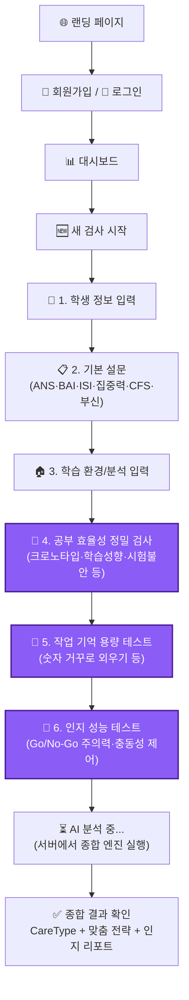

# NBASS 백엔드 + 웹앱 전환 및 연동 실행 계획 (v4)

## 확정된 전제 조건
- **도메인**: 미확보 (Week 1 등록)
- **Supabase**: 신규 생성 (Seoul 리전)
- **웹앱 디자인**: 신규 웹 최적화 디자인 적용 (Calm Science 컨셉)
- **기존 Electron 앱**: PC용 전문가 도구로 유지, 클라우드 DB 연동 (Hybrid Sync)
- **개인정보보호**: Week 1에서 처리방침 및 동의서 작성
- **MVP 필수 기능 추가**: 공부 효율성 검사, 작업 기억 용량 테스트, 인지 성능 테스트 포함 확정

---

## 🏗️ 아키텍처: Hybrid Sync (온라인-오프라인 연동)

```mermaid
flowchart TD
    subgraph "클라우드 인프라 (Supabase)"
        DB[(PostgreSQL\n중앙 데이터베이스)]
        Auth[Auth\n(인증 관리)]
    end

    subgraph "학생용 웹앱 (Next.js / Vercel)"
        WebUI[웹 브라우저\n스마트폰/PC]
        WebAPI[Next.js API]
        WebUI <-->|로그인 / 모든 설문+인지테스트 / 결과 확인| WebAPI
        WebAPI <--> DB
        WebUI -.-> Auth
    end

    subgraph "전문가용 PC앱 (기존 Electron)"
        ElecUI[PC 앱 화면]
        LocalDB[(IndexedDB\n로컬 캐시)]
        Hardware[HRV / EEG\n측정 기기]
        
        Hardware --> ElecUI
        ElecUI <--> LocalDB
        ElecUI <-->|API 호출 / 동기화| DB
        ElecUI -.-> Auth
    end
```

---

## 🔄 MVP 사용자 플로우 (확장형)

학생이 웹앱에서 단독으로 진행하는 검사의 범위가 대폭 확장되었습니다. (소요 시간 증가 예상)



---

## 💻 웹앱 마이그레이션 전략 업데이트

기존에 제외하려 했던 복잡한 컴포넌트들을 웹앱으로 함께 이관합니다. 인터랙티브 컴포넌트(게임 등)이므로 React 19 / Next.js 클라이언트 컴포넌트(`"use client"`) 환경에 맞게 리팩토링이 필요합니다.

### ✅ 추가로 이관해야 할 핵심 코드

| SN1 원본 (Electron) | 웹앱 타겟 위치 | 주요 작업 내용 |
|---------------------|---------------|---------------|
| `StudyEfficiencyAssessment.tsx` (34KB) | `components/assessment/StudyEfficiency.tsx` | UI 리디자인, 컨텍스트 상태를 로컬 상태로 변경 |
| `WorkingMemoryAssessment.tsx` (28KB) | `components/assessment/WorkingMemory.tsx` | 타이머/상태 로직 확인 및 리디자인 |
| `CognitivePerformanceAssessment.tsx` (85KB)| `components/assessment/CognitiveTest.tsx` | 캔버스/이벤트 리스너 분리 및 최적화 |
| `components/games/` 폴더 | `components/games/` | DigitSpan, StroopTest 등 미니게임 이관 및 최적화 |
| `contexts/StudyEfficiencyContext.tsx` | `hooks/use-study-efficiency.ts` | 훅으로 변환하여 상태 관리 간소화 |
| `data/studyEfficiencyAssessments.ts` 등 | `data/` | 관련 지식 베이스 파일 이관 |

---

## 🗄️ DB 스키마 수정 (Supabase)

`assessments` 테이블에 새로 추가된 검사 데이터를 담을 JSON 컬럼을 추가합니다.

```sql
ALTER TABLE public.assessments 
  ADD COLUMN study_efficiency_data JSONB,
  ADD COLUMN working_memory_result JSONB,
  ADD COLUMN cognitive_performance_result JSONB;
```

---

## 🗓️ 주차별 세부 실행 계획 (총 6주)

기존 4주 MVP 계획에서 **인지/작업기억 테스트 이관 및 UI 작업**을 위해 2주가 추가되었습니다.

### Week 1: 인프라 + 인증 + 디자인 기초
- [ ] 도메인 등록, Supabase 프로젝트 생성 (Seoul 리전)
- [ ] DB 스키마 SQL 실행 및 RLS 정책 적용
- [ ] Next.js 15 프로젝트 생성, `globals.css` 디자인 시스템 구축
- [ ] 로그인 / 회원가입 페이지 (동의 체크박스 포함)
- [ ] 개인정보 처리방침, 이용약관 작성

### Week 2: 핵심 진단 엔진 API + 기본 설문 UI
- [ ] `logicEngine.ts`, `clinicalEngine.ts` 등 서버(API)로 이관
- [ ] `POST /api/assess/run` 통합 진단 파이프라인 개발
- [ ] 검사 시작 ~ 기본 설문(6종) UI 이관 및 리디자인
- [ ] 학습 환경 / 학습 분석 UI 리디자인

### Week 3: [신규] 공부 효율성 & 인지 테스트 게임 UI 이관
- [ ] 공부 효율성 정밀 검사 이관 (크로노타입, VARK, 불안, 중독 등)
- [ ] 작업 기억 용량 테스트(Digit Span 등) 컴포넌트 이관
- [ ] 인지 성능 테스트(Go/No-Go 등) 캔버스/이벤트 로직 분리 및 이관
- [ ] 각 인터랙티브 테스트의 모바일 반응형 처리 (터치 대응)

### Week 4: 테스트 통합 및 대시보드
- [ ] 검사 전체 플로우(Step 1 ~ 6) 묶기 및 상태 관리
- [ ] 백엔드 `POST /api/assess/run`에 인지 테스트 데이터 반영
- [ ] 학생 대시보드 및 검사 이력 목록 화면 개발
- [ ] 성적 입력 및 성적 추이 UI 개발

### Week 5: 종합 결과 리포트 UI
- [ ] 결과 페이지 분석 중 로딩 애니메이션
- [ ] CareType 결과 카드 (기본 리포트)
- [ ] 맞춤 전략 패널 (영양/학습/운동/루틴)
- [ ] **인지/효율성 분석 전용 리포트 섹션 추가** (그래프/차트 위주)

### Week 6: 배포 및 Electron PC 앱 연동 (Hybrid Sync)
- [ ] 랜딩 페이지 개발 및 SEO 설정
- [ ] Vercel 배포 및 최종 통합 스모크 테스트
- [ ] 기존 Electron 앱에 Supabase 연동 코드 삽입 (전문가 로그인)
- [ ] Electron `database.ts` 수정: Supabase 동기화 로직 추가

---

## User Review Required

> [!WARNING]
> 인지 성능 테스트나 작업 기억 용량 테스트 같은 **게임형 테스트는 모바일 환경(작은 화면, 터치 입력)에서 UX가 PC 마우스 환경과 크게 다를 수 있습니다.**
> 
> **질문:** 
> 모바일 환경에서도 해당 테스트들이 문제없이 진행될 수 있도록 반응형/터치 대응 작업을 진행하겠습니다. 단, 기존 Electron 앱(PC 전용) 대비 인터페이스의 크기나 배치 조정을 제가 유연하게 수정해도 될까요?
