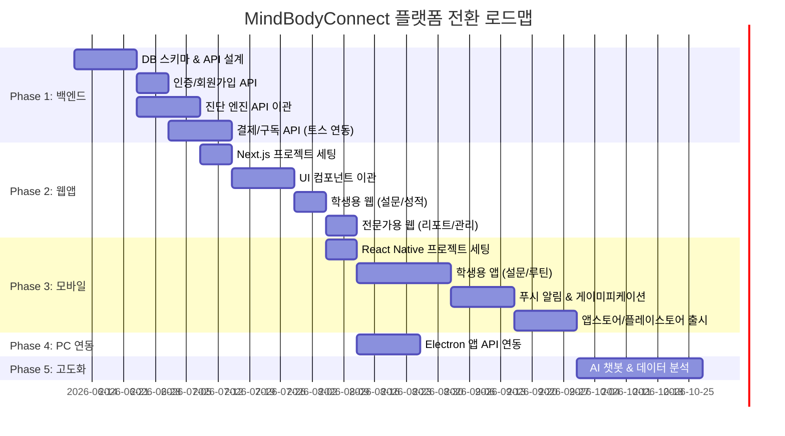

# MindBodyConnect 플랫폼 전환 로드맵

## 현재 상태 (AS-IS)
- **Electron 데스크탑 앱** (React + Vite + TypeScript)
- **로컬 데이터베이스** (Dexie/IndexedDB)
- **핵심 엔진 완성**: 진단 분류(clinicalEngine), 처방(prescriptions), 리포트(MedicalReport, NeuroInsightReport)
- **HRV/EEG/설문 기반 통합 분석** 로직 완비
- **인터넷 연결 불필요** (모든 것이 PC 로컬에서 동작)

## 목표 상태 (TO-BE)
- **클라우드 기반 SaaS 플랫폼**
- **웹앱 + PC앱 + Android + iOS** 멀티플랫폼
- **회원가입/구독 결제** 시스템
- **역할 분리**: 학생(B2C) / 학부모(보호자) / 전문가(원장님·의료진)

---

## 🏗️ 전체 아키텍처

```
┌─────────────────────────────────────────────────────┐
│                    클라이언트 (Client)                │
│                                                      │
│  ┌──────────┐  ┌──────────┐  ┌───────────────────┐  │
│  │  웹앱    │  │ 모바일앱  │  │  PC 데스크탑앱    │  │
│  │ (Next.js)│  │(React    │  │  (기존 Electron)  │  │
│  │          │  │ Native)  │  │                    │  │
│  └────┬─────┘  └────┬─────┘  └────────┬──────────┘  │
│       │              │                 │             │
└───────┼──────────────┼─────────────────┼─────────────┘
        │              │                 │
        ▼              ▼                 ▼
┌─────────────────────────────────────────────────────┐
│                  백엔드 API 서버                      │
│              (Node.js + Express/Fastify)              │
│                                                      │
│  ┌────────────┐ ┌────────────┐ ┌──────────────────┐ │
│  │ 인증/권한   │ │ 결제/구독   │ │ 진단 엔진 API    │ │
│  │ (Auth)     │ │ (Payment)  │ │ (Clinical API)   │ │
│  └────────────┘ └────────────┘ └──────────────────┘ │
│  ┌────────────┐ ┌────────────┐ ┌──────────────────┐ │
│  │ 학생 관리   │ │ 성적/학습   │ │ 알림/푸시        │ │
│  │ (Student)  │ │ (Academic) │ │ (Notification)   │ │
│  └────────────┘ └────────────┘ └──────────────────┘ │
└──────────────────────┬──────────────────────────────┘
                       │
                       ▼
┌─────────────────────────────────────────────────────┐
│                   데이터베이스                        │
│                                                      │
│  ┌──────────────┐  ┌──────────────┐  ┌────────────┐ │
│  │ PostgreSQL   │  │ Redis        │  │ S3/Storage  │ │
│  │ (메인 DB)    │  │ (캐시/세션)   │  │ (리포트PDF) │ │
│  └──────────────┘  └──────────────┘  └────────────┘ │
└─────────────────────────────────────────────────────┘
```

---

## 📋 Phase 1: 백엔드 API 서버 구축 (약 4~6주)

> **목표**: 현재 로컬에서만 동작하는 진단 엔진을 클라우드 API로 전환

### 1-1. 기술 스택 선정

| 영역 | 기술 | 선정 이유 |
|------|------|-----------|
| 서버 프레임워크 | **Node.js + Fastify** | 기존 TypeScript 코드 그대로 재활용 |
| 데이터베이스 | **PostgreSQL + Prisma ORM** | 관계형 데이터(학생-검사-성적) 관리에 최적 |
| 인증 | **Firebase Auth** 또는 **NextAuth.js** | 소셜 로그인(카카오/네이버/구글) 즉시 지원 |
| 캐시 | **Redis** | 세션 관리, 실시간 알림 큐 |
| 파일 저장 | **AWS S3** 또는 **Supabase Storage** | PDF 리포트, 프로필 이미지 등 |
| 배포 | **AWS EC2/ECS** 또는 **Vercel + Railway** | 초기에는 Vercel 추천 (빠른 배포) |

### 1-2. 핵심 API 설계

```
[인증 API]
POST   /api/auth/register          회원가입
POST   /api/auth/login             로그인
POST   /api/auth/refresh           토큰 갱신
GET    /api/auth/me                내 정보 조회

[구독/결제 API]
GET    /api/subscription/plans     구독 플랜 목록
POST   /api/subscription/checkout  결제 시작 (토스/포트원 연동)
POST   /api/subscription/webhook   결제 완료 콜백
GET    /api/subscription/status    내 구독 상태 확인

[학생 관리 API]
GET    /api/students               학생 목록 (전문가용)
POST   /api/students               학생 등록
GET    /api/students/:id           학생 상세 조회

[검사/진단 API]
POST   /api/assessments            새 검사 생성 (설문 결과 전송)
PATCH  /api/assessments/:id/hrv    HRV 데이터 추가 입력
PATCH  /api/assessments/:id/eeg    EEG 데이터 추가 입력
GET    /api/assessments/:id        검사 결과 조회
GET    /api/assessments/:id/report 진단 리포트 (PDF) 다운로드
GET    /api/assessments/history    내 검사 이력 검색

[성적/학습 API]
POST   /api/grades                 성적 입력
GET    /api/grades/trend           성적 추이 조회
GET    /api/study-plan             맞춤형 공부 Plan 생성 (AI)

[알림 API]
POST   /api/notifications/push     푸시 알림 전송
GET    /api/notifications          알림 목록
```

### 1-3. 데이터베이스 스키마 (핵심 테이블)

```
Users (사용자)
├── id, email, password_hash, name, phone
├── role: STUDENT | PARENT | EXPERT | ADMIN
├── subscription_plan: FREE | BASIC | PREMIUM
├── subscription_expires_at
└── created_at, updated_at

Students (학생 프로필)
├── id, user_id (FK → Users)
├── name, birth_date, gender, school, grade
├── height, weight, bmi
└── parent_user_id (FK → Users, nullable)

Assessments (검사 기록)
├── id, student_id (FK → Students)
├── assessment_date
├── survey_data (JSON) ← 설문 결과
├── hrv_data (JSON) ← HRV 측정값 (나중에 추가 가능)
├── eeg_data (JSON) ← EEG 측정값 (나중에 추가 가능)
├── classification_result (JSON) ← 엔진 분석 결과
├── analysis_text (TEXT) ← 생성된 리포트 텍스트
├── care_type, care_score
├── status: SURVEY_ONLY | HRV_ADDED | FULL_ASSESSMENT
└── created_by_role: SELF | EXPERT

Grades (성적)
├── id, student_id (FK → Students)
├── exam_type (중간/기말/모의고사)
├── subject, score, grade_rank
├── exam_date
└── created_at

StudyPlans (학습 계획)
├── id, student_id, assessment_id
├── plan_data (JSON) ← AI 생성 공부 Plan
├── daily_routines (JSON)
└── created_at

Subscriptions (구독 이력)
├── id, user_id
├── plan: BASIC | PREMIUM
├── payment_provider, payment_id
├── starts_at, expires_at, status
└── amount, currency
```

---

## 📋 Phase 2: 웹앱 전환 (약 3~4주)

> **목표**: 기존 React UI를 Next.js 웹앱으로 마이그레이션

### 2-1. Next.js 프로젝트 구조

```
web-app/
├── app/
│   ├── (auth)/
│   │   ├── login/page.tsx          로그인
│   │   ├── register/page.tsx       회원가입
│   │   └── subscription/page.tsx   구독 플랜 선택
│   │
│   ├── (student)/                  ← 학생용 (B2C)
│   │   ├── dashboard/page.tsx      내 대시보드
│   │   ├── assessment/page.tsx     설문 검사 진행
│   │   ├── grades/page.tsx         성적 입력
│   │   ├── study-plan/page.tsx     맞춤형 공부 Plan
│   │   ├── history/page.tsx        내 검사 이력
│   │   └── routine/page.tsx        루틴 트래커
│   │
│   ├── (expert)/                   ← 전문가용 (원장님)
│   │   ├── dashboard/page.tsx      센터 대시보드
│   │   ├── students/page.tsx       학생 목록/관리
│   │   ├── assessment/page.tsx     HRV/EEG 추가 입력
│   │   └── reports/page.tsx        전문 리포트 출력
│   │
│   ├── (parent)/                   ← 학부모용
│   │   ├── dashboard/page.tsx      내 아이 현황
│   │   └── reports/page.tsx        리포트 열람
│   │
│   └── api/                        ← API Routes (BFF)
│       └── ...
│
├── components/                     ← 기존 SN1 컴포넌트 이관
│   ├── NeuroInsightReport.tsx
│   ├── reports/MedicalReport.tsx
│   └── ...
│
├── services/                       ← 기존 엔진 코드 이관
│   ├── clinicalEngine.ts
│   ├── recommendationEngine.ts
│   └── ...
│
└── lib/
    ├── api-client.ts               서버 API 호출 래퍼
    ├── auth.ts                     인증 유틸
    └── subscription.ts             구독 상태 체크
```

### 2-2. 기존 코드 재활용 전략

| 기존 파일 | 재활용 방법 |
|-----------|------------|
| `clinicalEngine.ts` | **서버 API로 이관** (진단은 서버에서 실행) |
| `vitalityFatigueInsights.ts` | 서버 API로 이관 |
| `NeuroInsightReport.tsx` | **웹앱 컴포넌트로 그대로 이관** |
| `MedicalReport.tsx` | 웹앱 컴포넌트로 그대로 이관 |
| `Charts.tsx` | 웹앱 컴포넌트로 그대로 이관 |
| `ExpertOverlay.tsx` | 전문가 모드 전용으로 이관 |
| `database.ts` (Dexie) | **서버 PostgreSQL로 교체** (API 호출로 변환) |
| `printUtils.ts` | 서버 사이드 PDF 생성으로 교체 |

### 2-3. 구독 등급별 기능 접근 제어

| 기능 | FREE | BASIC (₩19,900/월) | PREMIUM (₩29,900/월) |
|------|------|------|---------|
| 기본 설문 검사 | ✅ (1회) | ✅ 5회 | ✅ 10회 |
| 간단 성향 분석 | ✅ | ✅ | ✅ |
| 상세 진단 리포트 | ❌ | ✅ | ✅ |
| 성적 입력 & 추이 | ❌ | ✅ | ✅ |
| AI 맞춤 공부 Plan | ❌ | ❌ | ✅ |
| 모바일 앱 루틴 관리 | ❌ | ❌ | ✅ |
| HRV/EEG 정밀 진단 | ❌ | ❌ | ✅ (센터 방문) |
| 전문가 1:1 상담 | ❌ | ❌ | ✅ |
| 학부모 리포트 공유 | ❌ | ❌ | ✅ |
| 검사 이력 보관 | 30일 | 1년 | 무제한 |

---

## 📋 Phase 3: 모바일 앱 개발 (약 6~8주)

> **목표**: Android + iOS 동시 출시

### 3-1. 기술: React Native + Expo

```
mobile-app/
├── app/
│   ├── (tabs)/
│   │   ├── home.tsx              홈 대시보드
│   │   ├── assessment.tsx        간편 설문 검사
│   │   ├── routine.tsx           오늘의 루틴 체크리스트
│   │   ├── grades.tsx            성적 입력/추이
│   │   └── profile.tsx           내 정보/구독 관리
│   │
│   ├── assessment/
│   │   ├── survey.tsx            설문 진행 화면
│   │   └── result.tsx            결과 확인
│   │
│   └── notifications/
│       └── settings.tsx          알림 설정
│
├── components/
│   ├── CircularSchedule.tsx      골든타임 원형 시간표
│   ├── RoutineCard.tsx           루틴 체크 카드
│   ├── StressGauge.tsx           스트레스 게이지
│   └── GradeChart.tsx            성적 추이 차트
│
└── services/
    └── api.ts                    백엔드 API 연동
```

### 3-2. 모바일 앱 핵심 기능

**학생용 모바일 앱:**
- 📋 간편 설문 검사 (언제 어디서나)
- ✅ 오늘의 루틴 체크리스트 (처방된 루틴을 매일 체크)
- 🔔 푸시 알림 (골든타임 시작, 휴식 시간, 루틴 리마인더)
- 📊 내 성적 입력 & 추이 그래프
- 📖 AI 맞춤 공부 Plan 열람
- 🏆 루틴 달성 뱃지 & 연속 출석 스트릭

**학부모용 모바일 앱 (동일 앱, 역할 전환):**
- 👨‍👩‍👧 내 아이 대시보드 (루틴 달성률, 스트레스 추이)
- 📄 진단 리포트 열람
- 💳 구독 관리 & 결제

---

## 📋 Phase 4: PC 데스크탑 앱 연동 (약 2주)

> **목표**: 기존 Electron 앱을 클라우드와 동기화

### 변경 사항
- `database.ts`의 Dexie 호출을 **API 호출로 래핑** (오프라인 시 로컬 캐시 유지)
- HRV/EEG 측정 후 **서버에 자동 업로드** (기존 로컬 저장과 병행)
- 로그인/인증 추가 (전문가 계정으로 로그인)
- 학생이 웹에서 입력한 설문 결과를 **PC에서 불러와서** HRV/EEG 추가 입력 가능

---

## 📋 Phase 5: 고도화 (지속적)

### 5-1. AI 학습 페이스메이커 챗봇
- 학생의 진단 데이터 + 성적 데이터를 맥락(Context)으로 제공
- "오늘 집중이 안 돼요" → AI가 현재 상태 기반 실시간 조언

### 5-2. 데이터 분석 & ROI 증명
- 루틴 실천률 vs 성적 향상 상관관계 분석
- "이 프로그램을 3개월 이용한 학생의 평균 성적 향상: +12점" 통계

### 5-3. 센터 CRM (전문가용 고급 기능)
- 다수 학생 일괄 관리
- 상담 일지 기록
- 매출/구독자 현황 대시보드

---

## 🗓️ 전체 타임라인 요약



---

## 💰 예상 운영 비용 (월간)

| 항목 | 초기 (0~100명) | 성장기 (100~1000명) | 안정기 (1000명+) |
|------|---------------|-------------------|-----------------|
| 서버 (Vercel/AWS) | ₩0~3만 | ₩10~30만 | ₩50~100만 |
| DB (PostgreSQL) | ₩0 (무료 티어) | ₩5~15만 | ₩20~50만 |
| Redis | ₩0 (무료 티어) | ₩3~5만 | ₩10만 |
| 파일 저장 (S3) | ₩0~1만 | ₩3~5만 | ₩10~20만 |
| 결제 수수료 | PG 3.5% | PG 3.5% | PG 3.0% (협상) |
| 푸시 알림 (FCM) | ₩0 (무료) | ₩0 (무료) | ₩0 (무료) |
| **합계** | **~₩5만** | **~₩50만** | **~₩200만** |

> [!TIP]
> 초기에는 Vercel(웹) + Supabase(DB+인증+스토리지)를 사용하면 **무료 또는 월 5만 원 이하**로 시작 가능합니다.

---

## 🎯 추천 시작점

> [!IMPORTANT]
> **Phase 1 + Phase 2를 동시에 시작**하는 것을 추천합니다.
> 
> 가장 빠르게 사업 가치를 만들 수 있는 첫 번째 목표:
> 
> **"학생이 인터넷(웹)에서 회원가입 → 설문 검사 → 기본 진단 리포트 확인"**
> 
> 이것이 완성되면 즉시 무료 체험판(FREE tier)으로 사용자를 모을 수 있고,
> 이후 결제/모바일 기능을 하나씩 붙여나가면 됩니다.
